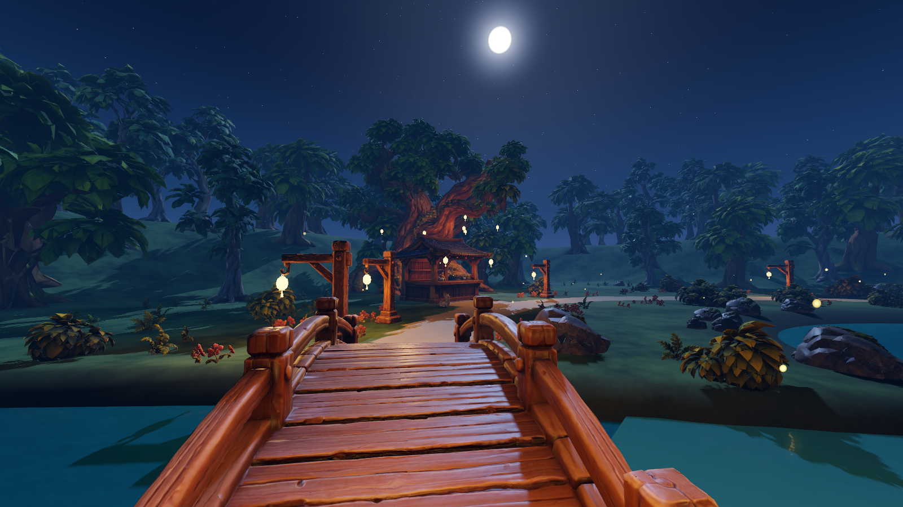

# Lantern Hollow

A small, cozy first-person night-garden game made with **Godot 4.7.2**. Every character, prop and plant started as a [Tripo](https://www.tripo3d.ai) 3D model and was cleaned up, rigged and animated with Blender scripts in `tools/`.



## Play it locally (fork → Godot)

You only need **Godot 4.7.2** (the standard build, not the .NET/C# one). There's nothing else to install.

1. **Get Godot 4.7.2** from <https://godotengine.org/download/archive/4.7.2-stable/> and unzip it anywhere. Godot doesn't need installing; the `.exe` just runs.
2. **Get the code:** fork this repo on GitHub, then clone your fork (or click **Code → Download ZIP**):
   ```bash
   git clone https://github.com/<your-username>/lantern-hallow.git
   ```
3. **Open the project:** start Godot, click **Import**, pick `lantern-hallow/game/project.godot`, then **Import & Edit**.
4. **Wait for the first import.** On the first open, Godot converts all models, textures and sounds, which takes a few minutes and about 1 GB of disk in `game/.godot/` (not committed). Later opens are quick.
5. **Press F5** (or the ▶ button at the top right) to play.

From a terminal, run this from the repo root (`godot` is your Godot 4.7.2 executable):

```bash
godot --path game
```

**Requirements:** a GPU with Vulkan support for the desktop renderer (Forward+); any gaming GPU from the last ~8 years works. On a laptop with two GPUs, make Godot use the dedicated one (Windows: *Settings → System → Display → Graphics*).

**Saves** go to `%APPDATA%\Godot\app_userdata\Lantern Hollow\save.json` on Windows (`~/.local/share/godot/app_userdata/Lantern Hollow/` on Linux). In the pause menu, *Restart from the beginning* wipes progress; settings are kept.

## Controls

| Key | Action |
| --- | --- |
| WASD / arrows | Walk |
| Space | Jump |
| Mouse | Look |
| E | Interact, advance dialogue, stand up |
| Right-click / E | Cast, strike and reel when fishing |
| 1–4 | Pick a dialogue option (mouse works too) |
| Esc | Pause (cancel fishing from here), or skip a conversation |
| H | Hide / show HUD |
| F11 | Fullscreen |

## Build it yourself

First, in the Godot editor: **Editor → Manage Export Templates → Download and Install** (one time; must match 4.7.2). Then use **Project → Export**, or run from the repo root:

```bash
# Windows .exe (single file, game data embedded)
godot --headless --path game --export-release "Windows Desktop" ../build/LanternHollow.exe

# Browser version (WebGL 2, no threads, so it works on itch.io)
godot --headless --path game --export-release "Web" ../build/web/index.html
```

To play the browser build locally, serve the folder over HTTP. Opening `index.html` directly from disk doesn't work:

```bash
python -m http.server 8061 --directory build/web
```

Then open <http://localhost:8061>. The first load takes 20–40 s (about 260 MB). Chrome runs it best; on a two-GPU laptop, set Chrome to the dedicated GPU as above.

## What's in the repo

```
lantern-hallow/
  game/            Godot project (scenes, scripts, shaders, assets): open game/project.godot
  tools/           Python/Blender/PowerShell pipeline: model cleanup, rigging, SFX building
  audio_src/       the recorded sound-effect takes that tools/build_sfx.py turns into game sounds
  blender/         keeper_showcase.blend: rigged keeper + plants, for the workflow video
  pack/            original design pack (art direction, concepts, model reference images)
  lantern-hollow/  newer reference pack (v4) with model prompts
  screenshots/     in-game captures
  PROGRESS.md      full dev log, session by session
  NEW_MODELS.md    Tripo prompts for the models
```

Raw Tripo downloads (several GB) and the builds aren't in git; the cleaned, game-ready models are in `game/assets/models/`.

## The game

Gather 3 moonleaves → brew tea and serve the fox (+3 coins, bait shop opens) → meet the blue spirit and buy bait (first purchase lends the rod) → catch and release a Moonfin (+2 coins, wish lantern) → light both dock lanterns → release the wish lantern together. Afterwards: free fishing, the bench, three optional hidden charms.

Fishing: `IDLE → CASTING → WAITING (4–7 s) → BITE (waits for you) → REELING → CATCH_REVEAL → RELEASING`. Bait and coins only change at the end of the release, all at once; cancelling, quitting or restarting before then costs nothing.

## Code map

| Area | Files |
| --- | --- |
| Progress, save/load, all reward rules | `scripts/autoload/game_state.gd` |
| Current objective text | `scripts/objectives.gd` |
| HUD, dialogue, pause, toasts | `scripts/autoload/ui.gd` |
| Audio buses, one-shots, loops, music | `scripts/autoload/sfx.gd`, `scripts/autoload/settings.gd` |
| Player, interaction ray | `scripts/player/player.gd` |
| NPCs | `scripts/npcs/*.gd` |
| Kettle, cup, moonleaves, lanterns, bench, charms | `scripts/interactables/*.gd` |
| Fishing state machine | `scripts/fishing/fishing_controller.gd` |
| Terrain, water, sky, lights, foliage, boundaries | `scripts/world/world.gd`, `shaders/*.gdshader` |
| Tree, stall, bridge, dock + their colliders | `scripts/world/prop.gd` |
| Garden coordinates | `scripts/world/layout.gd` |

Everything placed by hand (NPCs, stall, dock, leaves, lanterns, bench) is a node in `scenes/main.tscn`, so it can be moved in the editor.

## Swapping in real models (Tripo → Blender → Godot)

Every NPC, prop and interactable is a **wrapper**: gameplay, ids and colliders live on the wrapper, and the look is built from a `model` slot. Empty slot = primitive placeholder.

1. Generate from **one standalone PNG at a time** (in `pack/…`), check all sides in Blender, apply transforms, put the pivot at the feet/base, and export `.glb`.
2. Drop it in `game/assets/models/`.
3. In the editor select the node in `main.tscn` and drag the `.glb` onto its **Model** property (adjust **Model Scale** if needed). For the rod and Moonfin use the `Fishing` node's *Rod Model* / *Fish Model*; for the wish lantern the `Celebration` node.

Placeholders face **+Z**; Tripo GLBs usually do too. Suggested priority: giant tree trunk + canopy, tea stall, keeper, fox, moss spirit, blue spirit, Moonfin, rod. Bridge, dock, bench, lanterns, bobber and coin are fine as simple Blender builds or the current placeholders.

## Tests and captures (dev tools)

```bash
godot --headless --path game -- --autotest
```

Plays the whole game in-engine and checks 49 rules: order of quests, wrong-order hints, rewards paid once, 4 coins / 0 bait after tea → buy → release, cancel/pause/repeated-E safety, zero-bait casting, save/load round trip, ending, fishing after the ending, bench, recovery bait, corrupted-save cleanup and restart. It uses its own save file, never yours.

```bash
godot --path game -- "--capture=../screenshots" --fish
```

Renders the hero views (arrival bridge, dock, tea counter and more), a fishing sequence, a shop dialogue and an aerial view, and prints FPS per view.

## Status

**Done and tested:** all four quests, wrong-order hints, bait shop + rod loan, full fishing state machine with atomic commit, pause/cancel/restart, autosave with schema version and sanitizing, HUD/H toggle, dialogue with choices, bench, three charms, finale with rising lanterns, audio buses with saved volume and mouse sensitivity.

**Measured (with all real models):** 56–119 FPS at 1600×900 on an RTX 3050 6 GB Laptop GPU, run from the editor. The spawn view, which looks across the whole garden, is the slowest.

**Real models (Tripo → `tools/` → game):** keeper, fox, moss spirit, blue spirit, giant tree (+ canopy cut from a forest tree), tea stall, bridge, bench, lantern posts, lanterns, kettle, cups, bait jar, moonleaves, charms, wish lantern, forest trees, shrubs, ferns, flowers, lily pads, rocks. Raw downloads and intermediate cleaned copies lived in `models_raw/` (not in this repo, too big); the final models are in `game/assets/models/`.

| Tool | What it does |
| --- | --- |
| `tools/batch_prepare.ps1` + `tools/prepare_model.py` | Shrinks raw Tripo GLBs (~2M tris → per-role budget), 2K/1K textures, real-world size, origin at the feet, two-sided materials, preview renders |
| `tools/rig_keeper.py` | Humanoid skeleton + voxel-proxy weights + idle/talk/wave/happy for the keeper |
| `tools/rig_creature.py` | Shape-weighted rigs + idle/talk/happy/drink for fox, moss spirit, blue spirit |
| `tools/render_beauty.py` | Full-material preview under game-style night lighting |

**Living garden:**
- **Pond:** clear water you can see into, plus a half-resolution mirror reflection (`scripts/world/water_reflection.gd`).
- **Fish:** 13 glowing fish wander the pond and sometimes leap out (`pond_life.gd`).
- **Wind:** foliage sways, and the hanging lanterns swing on their hooks.
- **Ambient life:** wandering light wisps, moths around lanterns, mist and motes over the pond, leaves drifting from the giant tree, frog croaks and owl hoots (`ambient_life.gd`).
- **Stall:** the shelves hold glowing potions.

Tripo prompts for the models are listed in [NEW_MODELS.md](NEW_MODELS.md).

**Audio:** music and ambience are synthesized by `tools/gen_audio.py`; sound effects come from recorded takes in `audio_src/`, built by `tools/build_sfx.py`.

## Credits

- Design pack: produced with ChatGPT for this project.
- 3D models: generated with Tripo, then cleaned up and rigged with the scripts in `tools/`.
- Sound effects: generated with ElevenLabs.
- Code, shaders and procedural audio: written for this project.
- Engine: [Godot Engine](https://godotengine.org) (MIT).
